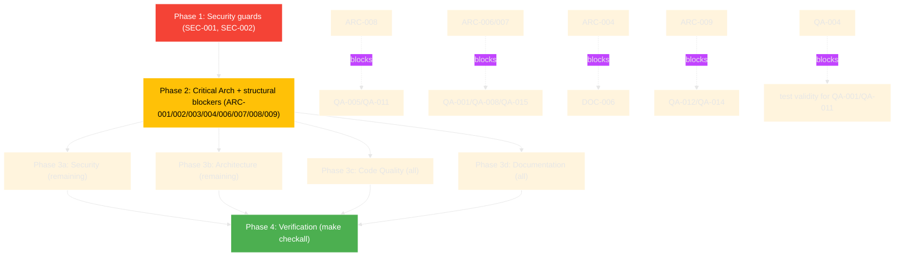

# Project Audit Report

> **Project**: parmoji
> **Date**: 2026-07-30
> **Stack**: Python 3.11–3.13 · Pillow · httpx/requests/urllib · emoji · xdg-base-dirs · hatchling · ruff/pyright/pytest
> **Audited by**: Claude Code Audit System (`/audit`, sonnet subagents across 4 domains)
> **Branch audited**: `next-big-thing` @ `91c8f67` (2 commits ahead of origin; CI workflow files staged)

---

## Executive Summary

Parmoji is a well-factored, small (~2,035 LOC across 4 source modules) Pillow-based emoji rendering library in **good** overall health. The objective gates are exemplary — **99% line coverage, 116 passing tests, 0 ruff violations, 0 pyright errors** — and the pluggable-source design, layered caching, and mature CI are genuine strengths. There are **no Critical security findings and no committed secrets**; supply-chain hygiene (PyPI OIDC trusted publishing, gitleaks pre-commit, TLS default-on) is solid.

The most urgent problems are **three Critical architecture/packaging defects that ship silently**: a missing `py.typed` marker that voids the library's "Typed" claim for every downstream consumer, animated Discord emoji that always fetch as a static PNG (the primary differentiating feature silently fails), and `Parmoji.open()` leaving the default httpx backend dead after a close/reopen. Beneath those, the dominant theme is **an incoherent dependency contract** — `pyproject.toml` hard-requires `httpx`/`requests`/`emoji`/`xdg-base-dirs` while the source treats them as optional (dead urllib fallback, contradicting README), and pervasive broad `except Exception` handling combined with autouse test fixtures that synthesize cache state means **rendering/caching failures can hide behind green CI**.

Remediating the 3 Critical + 11 High issues is a focused effort (most are localized fixes or one shared refactor); the Medium/Low items are incremental improvements. Estimated effort for the top issues: **~2–3 days**, dominated by the `BaseSource` contract/cache refactor and the test-fixture overhaul.

### Issue Count by Severity

| Severity | Architecture | Security | Code Quality | Documentation | Total |
|----------|:-----------:|:--------:|:------------:|:-------------:|:-----:|
| 🔴 Critical | 3 | 0 | 0 | 0 | **3** |
| 🟠 High     | 5 | 0 | 3 | 3 | **11** |
| 🟡 Medium   | 7 | 2 | 6 | 5 | **20** |
| 🔵 Low      | 7 | 4 | 9 | 6 | **26** |
| **Total**   | **22** | **6** | **18** | **14** | **60** |

---

## 🔴 Critical Issues (Resolve Immediately)

### [ARC-001] Missing `py.typed` marker voids the typed contract
- **Area**: Architecture / Packaging
- **Location**: `src/parmoji/` (file absent) vs `pyproject.toml:24` (`"Typing :: Typed"`) and `pyproject.toml:70` (`include = ["py.typed", ...]`)
- **Description**: The package advertises itself as PEP 561 typed (classifier + wheel include rule) but no `src/parmoji/py.typed` file exists on disk. The wheel-include rule ships a file that isn't there.
- **Impact**: Every downstream pyright/mypy treats the entire public API as `Unknown`/`Any`; the extensive type hints in `core.py`/`source.py` provide zero external value. The "Typed" classifier is false advertising.
- **Remedy**: Add an empty `src/parmoji/py.typed` and add a CI assertion that it ships in the built wheel.

### [ARC-002] Animated Discord emoji always fetched as static PNG (silent data loss)
- **Area**: Architecture / Correctness
- **Location**: `src/parmoji/helpers.py:165-168` (parser discards the animated flag), `src/parmoji/source.py:633-642` (`get_discord_emoji` hardcodes `.png`)
- **Description**: Discord custom emoji come in two forms — `<:name:id>` (static, PNG) and `<a:name:id>` (animated, GIF). `_parse_line` strips everything but the snowflake (`emoji_id = emoji_text.split(":")[-1][:-1]`), throwing away the leading `a`. `get_discord_emoji` then always builds `.../emojis/{id}.png`; for animated emoji the CDN serves GIF at `{id}.gif`, so the `.png` URL 404s and is recorded into the persistent `failed_requests.json` — permanently.
- **Impact**: Every animated Discord emoji silently fails to render and is never retried. This is the primary differentiating feature of "Discord custom emoji" support.
- **Remedy**: Preserve the animated flag (carry an `animated: bool` on the node or extend `Node`), and have `get_discord_emoji` request `.gif` for animated IDs (with a `.png` fallback).

### [ARC-003] `Parmoji.open()` does not restore the httpx client — leaves source dead
- **Area**: Architecture / Correctness
- **Location**: `src/parmoji/core.py:193-209`
- **Description**: `open()` only re-creates a `requests.Session` (line 206) and only `if _has_requests and isinstance(self.source, HTTPBasedSource)`. The default backend is httpx (`HTTPBasedSource.__init__` prefers it at `source.py:475`), and `close()` shuts that client down. After `close()` → `open()` on the default path, `_httpx_client` is closed and no new one is created — every subsequent `request()` falls through to urllib.
- **Impact**: Reopening a renderer (an explicitly supported operation with its own `ValueError` guard) silently degrades or breaks the default HTTP backend.
- **Remedy**: Move client lifecycle into `HTTPBasedSource` and have `Parmoji.open()` delegate; recreate whichever backend is configured.

---

## 🟠 High Priority Issues

### [ARC-004] Optional-import scaffolding contradicts hard dependencies (dead code + contract drift)
- **Area**: Architecture
- **Location**: `pyproject.toml:27-34` (httpx, requests, emoji, xdg-base-dirs all required) vs `src/parmoji/source.py:38-70` (`_has_requests`/`_has_httpx`/guarded `emoji`/guarded `xdg_cache_home`), `src/parmoji/helpers.py:20` (unguarded `import emoji`), `README.md:27` ("httpx / requests (optional fallback)")
- **Description**: Every "optional" library is in fact a hard dependency, so the `_has_httpx`/`_has_requests` branches are unreachable and the `try/except ImportError` guards are dead. The inconsistency cuts both ways: `helpers.py` imports `emoji` unconditionally while `source.py` defends against its absence — the two modules disagree. The README compounds it by calling httpx/requests optional. *(This subsumes the Documentation finding that README mislabels httpx/requests as optional.)*
- **Impact**: The urllib fallback (`source.py:590-604`) is untestable dead code that must still be maintained; readers cannot tell what is required; `pip install parmoji` pulls dependency trees the docs say are optional.
- **Remedy**: Pick one contract. Simplest given the size: declare them all required (current reality) and delete the guards + urllib fallback + the README "optional" claim. Alternatively, move to true `[project.optional-dependencies]` extras and keep the guards.

### [ARC-006] Unbounded `_processed_image_cache` is a memory leak
- **Area**: Architecture
- **Location**: `src/parmoji/core.py:188`, used at `core.py:689-700`
- **Description**: The two `LRUCacheDict` instances are bounded by `cache_size`, but `_processed_image_cache: Dict[str, Image.Image]` is a plain dict keyed by `f"{content}_{emoji_scale_factor}"` with no eviction. Every distinct (emoji, scale) pair permanently retains a full RGBA `Image`.
- **Impact**: A long-lived renderer (a bot or terminal emulator rendering many distinct emoji across many scales) grows without bound — the exact failure mode the LRU was introduced to prevent.
- **Remedy**: Use a third `LRUCacheDict` with a budget partitioned across the three caches, or `functools.lru_cache`.

### [ARC-007] LRU race — eviction closes `BytesIO` that callers still hold
- **Area**: Architecture / Concurrency
- **Location**: `src/parmoji/core.py:80-101` (eviction closes evicted stream under LRU `_lock`), `core.py:250-290` (`_get_emoji`/`_get_discord_emoji` read cached stream under a *different* `_cache_lock`), `core.py:234-238` (close iterates `.values()` lock-free)
- **Description**: Eviction runs under the LRU's internal `_lock` and `close()`s the evicted `BytesIO`. Callers fetch the cached stream under a separate `self._cache_lock`. Because the two locks are independent, thread B inserting can evict-and-close the stream thread A is mid-read on. `close()` also iterates the dict without any lock while concurrent `__setitem__` may mutate it.
- **Impact**: Sporadic `ValueError: I/O operation on closed file` under concurrent rendering, or `RuntimeError: OrderedDict mutated during iteration` on close.
- **Remedy**: Preferred — store **immutable `bytes`** (no closeable resource) and have callers wrap a fresh `BytesIO` per use (the code already half-does this), then drop `close()`-on-evict entirely. Otherwise unify the two locks.

### [ARC-008] LocalFontSource violates the source contract (LSP) and reimplements disk caching
- **Area**: Architecture
- **Location**: `src/parmoji/local_source.py:89-100` (`tight`/`margin` silently ignored), `local_source.py:169` (`get_discord_emoji` missing the ABC's `/` positional-only marker), `local_source.py:103-162` (reimplements disk read/write/clear instead of reusing `BaseSource`)
- **Description**: `BaseSource.get_emoji` declares `tight`/`margin` with documented semantics; `LocalFontSource` accepts and explicitly ignores them, while `EmojiCDNSource` honors them — two contracts behind one ABC. `get_discord_emoji` drops the `/`, so keyword calls through a `BaseSource`-typed reference raise `TypeError` only for this source. The disk-cache responsibility is smeared across `BaseSource`, `EmojiCDNSource._load_from_cache`/`_fetch_and_persist`, and `LocalFontSource`'s own `_get_cache_key`/read/write/clear. *(This subsumes the Code Quality finding [QA-002] about the missing positional-only marker.)*
- **Impact**: Callers programming to `BaseSource` get surprising behavior when the concrete source swaps; new sources must copy-paste cache code; cache bug fixes must be applied in two places.
- **Remedy**: Promote disk-cache read/write into template methods on `BaseSource` (`_cache_get(key)`, `_cache_put(key, bytes)`) so subclasses supply only the fetch/render step. Add `/` to `LocalFontSource.get_discord_emoji`. Either honor `tight` in `LocalFontSource` (it already computes a bbox) or formally split the ABC.

### [ARC-009] Three emoji-detection / measurement implementations, no single source of truth
- **Area**: Architecture
- **Location**: `src/parmoji/helpers.py:44` (`is_emoji`), `src/parmoji/source.py:100` (`is_valid_emoji`), `src/parmoji/helpers.py:77` (`find_emojis_in_text`); `PIL_VERSION`/`HAS_GETLENGTH` duplicated at `core.py:36-37` and `helpers.py:28-29`
- **Description**: `is_emoji` and `is_valid_emoji` overlap heavily (both consult `emoji.EMOJI_DATA`/`emoji_count`, both fall back to Unicode `So`/`Sk`) but diverge on edge cases (dingbat rejection, ZWJ/VS-16 handling, `MAX_EMOJI_SEQ_LEN`). They can disagree on the same input. The Pillow version probe is duplicated verbatim across two modules.
- **Impact**: An emoji may validate at the source layer but fail to parse at the helpers layer (or vice versa), producing inconsistent render behavior; any version-compat fix must be made twice.
- **Remedy**: Collapse into one detection module: a single `is_emoji`, a single `PIL_VERSION`/`HAS_GETLENGTH`, with `source.is_valid_emoji` delegating and adding only its length cap.

### [QA-001] `cache_size // 2` creates a `maxsize=0` LRU
- **Area**: Code Quality / Correctness
- **Location**: `src/parmoji/core.py:185` (constructor) vs `core.py:241` (reset in `close()`)
- **Description**: The constructor builds `LRUCacheDict(maxsize=cache_size // 2)` for the Discord cache with no lower bound, while `close()` correctly uses `max(1, self._cache_size // 2)`. For `Parmoji(img, cache_size=1)`, the Discord cache gets `maxsize=0`; `len(self) > self.maxsize` is `1 > 0` immediately, so every Discord-emoji entry is evicted on insert. The fix already exists 56 lines down — it was not back-ported to `__init__`.
- **Impact**: Discord-emoji caching silently degrades to "always empty" for `cache_size` of 1 (and insert-then-evict churn for small sizes). No test covers sub-default `cache_size`.
- **Remedy**: `LRUCacheDict(maxsize=max(1, cache_size // 2))`. Add a `cache_size=1` test asserting a Discord emoji round-trips through the cache. *(Note: target the post-fix cache shape — see blocking note tying this to ARC-006/ARC-007.)*

### [QA-003] Pervasive broad `except Exception` masks real failures
- **Area**: Code Quality
- **Location**: 28 `except Exception` sites across `src/parmoji/{core,source,helpers,local_source}.py` — e.g. `core.py:472` (`__del__` `pass`, no log), `source.py:436` (prime), `source.py:470/521/536/546` (cache load/save), `local_source.py:112/160/165/180`
- **Description**: Beyond the legitimate optional-import guards, most cache I/O, render, request, and tight-crop paths swallow `Exception` and continue at `logger.debug`. A corrupted cache, a full disk, or a Pillow API change looks identical to a "miss" and the system silently re-fetches or renders nothing.
- **Impact**: Operators get no signal when the caching/rendering subsystem is broken — only `WARNING`-level HTTP failures surface; programming errors (e.g. `AttributeError` from a Pillow API change) are absorbed silently.
- **Remedy**: Narrow to the specific expected exceptions (`OSError`, `json.JSONDecodeError`, `PIL.UnidentifiedImageError`, `KeyError`); promote persistent-cache write failures to `logger.warning`. Reserve bare `Exception` for the optional-import blocks.

### [QA-004] Test fixtures synthesize cache state, masking renderer failures
- **Area**: Code Quality / Test integrity
- **Location**: `tests/conftest.py:130-218` (`_ensure_local_source_png`, `_ensure_processed_cache_for_emoji`)
- **Description**: Two `autouse=True` fixtures monkeypatch `LocalFontSource.get_emoji` to return a synthetic PNG whenever the real renderer returns `None`, and patch `Parmoji.text`/`__exit__` to inject synthetic RGBA images into `_processed_image_cache` after every draw (unconditionally seeding `😀_1.0`/`😀_2.0` keys on every exit). Tests like `test_get_emoji_and_discord_cache_copy_semantics` then verify fixture-injected state, not production behavior.
- **Impact**: CI sandboxes without color-emoji fonts report green while the real renderer silently fails on every emoji; regressions in `_build_lines`/`_paste_emoji_for_line` that produce no asset are hidden.
- **Remedy**: Move the synthetic fallback to a per-test opt-in fixture (not `autouse`), or assert on `Image.paste` calls rather than cache contents. Remove the unconditional `😀_1.0`/`😀_2.0` seeding.
- **Blocking**: Land **before** relying on the test suite to validate QA-001 or QA-011 — today the fixtures would mask those failures.

### [DOC-001] `LocalFontSource` is undocumented in user-facing docs
- **Area**: Documentation
- **Location**: `README.md`, `docs/ARCHITECTURE.md` (both missing it); class at `src/parmoji/local_source.py`
- **Description**: `LocalFontSource` is the only non-HTTP source, has complete docstrings, ships in the wheel, and is the answer to the offline / no-network / system-font use case. The README "Emoji Sources and Caching" section describes only HTTP CDN sources; ARCHITECTURE.md refers generically to "local font" sources without ever naming the class.
- **Impact**: Users who need offline rendering — a primary reason to choose a local source — cannot discover the capability from the docs.
- **Remedy**: Add a README subsection naming `LocalFontSource`, showing `from parmoji.local_source import LocalFontSource` and a one-line instantiation; note `get_discord_emoji` is unsupported (returns `None`).

### [DOC-002] Release notes / README version desync at the current release
- **Area**: Documentation
- **Location**: `docs/RELEASE_NOTES.md` (stops at 2.0.7) vs `README.md:113-118` and `__version__ = "2.0.8"`
- **Description**: `__version__` and the README "What's New" both reference 2.0.8 ("Updated dependencies and ensure Python 3.13 compatibility"), but the canonical `docs/RELEASE_NOTES.md` has no 2.0.8 entry — it ends at `## 2.0.7 — 2025-09-14`.
- **Impact**: Anyone consulting RELEASE_NOTES.md (the file ARCHITECTURE.md and convention treat as the changelog) cannot see what changed in the latest release.
- **Remedy**: Add a `## 2.0.8 — <date>` section mirroring the README line, and keep the two in lockstep on every future release.

### [DOC-003] Package `__author__` metadata contradicts the manifest and the README
- **Area**: Documentation / Attribution (⚠️ sensitive metadata — needs maintainer decision)
- **Location**: `src/parmoji/__init__.py:5` (`__author__ = "jay3332"`, exported in `__all__`), `pyproject.toml` (authors/maintainers = Paul Robello), `README.md:124`
- **Description**: The README correctly frames jay3332 as the *original* Pilmoji author and Paul Robello as the current maintainer (pyproject lists only Paul Robello), but the package's introspectable `__author__` symbol still says `"jay3332"`, so `python -c "import parmoji; print(parmoji.__author__)"` reports the original author.
- **Impact**: Misattributes authorship on programmatic introspection; inconsistent with pyproject and the README acknowledgement.
- **Remedy**: Decide the intended value (e.g. `"Paul Robello"` with jay3332 credited only in README Acknowledgements, or a combined string) and update line 5. **Do not auto-apply — this is an attribution decision for the maintainer.**

---

## 🟡 Medium Priority Issues

### Architecture
- **[ARC-010] Inert "async-friendly" rationale.** `source.py:474` comment prefers httpx for "async-friendly operations," but only the sync `httpx.Client` is used and `Parmoji.text` is fully synchronous. Either add an async path or drop the rationale.
- **[ARC-011] `prime_cache` embeds a ~190-emoji inline literal.** `source.py:229-420` — a 190-line set literal inside the method body obscures the logic. Hoist to `_DEFAULT_PRIME_EMOJIS: Final[frozenset[str]]`. *(Subsumes QA-007.)*
- **[ARC-012] Single upstream CDN with no failover.** All 12 `EmojiCDNSource` styles route through one host (`emojicdn.elk.sh`, `source.py:648`); a host outage takes down every style. Document a pluggable CDN base or a "bring your own source" path.
- **[ARC-013] `__del__`-based cleanup on two classes + `close()`/`__del__` duplication.** `core.py:467-473`, `source.py:503-510` (and `source.py:614-621` duplicates the same close blocks). `__del__` can fire during interpreter shutdown or before `__init__` finished setting `_closed`/`_httpx_client`. Make the context manager the supported path; `__del__` at most a guarded backstop. *(Subsumes QA-010.)*
- **[ARC-015] Makefile runs `format` before `lint --fix`.** `Makefile:71` (`checkall: format lint typecheck test`). `ruff check --fix` can rewrite files *after* formatting, leaving auto-fixes unformatted in the committed state. Conventionally `lint` precedes `format`.
- **[ARC-016] `Parmoji.__init__` does too much.** `core.py:147-191` — 9 params plus source-class-vs-instance coercion, three cache allocations, and draw creation. Extract source coercion into a small factory.
- **[ARC-017] Type story eroded by broad `Any` and 32 `# type: ignore`.** `LRUCacheDict(OrderedDict[Any, Any])`, runtime `FontT = Any`/`ColorBaseT = Any`, blanket pyright disables at `core.py:33`/`helpers.py:14`. Making `LRUCacheDict` generic over key/value eliminates several ignores. *(Subsumes QA-013.)*

### Security
- **[SEC-001] Pillow `Image.open` on untrusted network-fetched bytes (decompression-bomb exposure).** `source.py:736`/`638` (fetch), opened at `source.py:762`, `core.py:565`, `core.py:693`. CDN bytes are parsed with no content-type check, no byte-size limit, and no explicit `Image.MAX_IMAGE_PIXELS` hardening beyond Pillow's default ~89 Mpx warning. A compromised CDN or MITM could deliver a decompression bomb or trigger a parser CVE. **Remedy:** cap response size (e.g. 2 MB), set an explicit `MAX_IMAGE_PIXELS` ceiling and catch `DecompressionBombError`, validate `Content-Type`, keep Pillow patched.
- **[SEC-002] Public `request()` accepts arbitrary URLs and follows redirects (SSRF surface for misuse).** `source.py:549` (clients at `479-484` with `follow_redirects=True`, `595` `urlopen`). Not reachable with attacker input through the normal API (URLs are built from validated emoji/discord IDs on fixed hosts), but a consumer calling `source.request(untrusted_url)` directly gets an SSRF oracle. **Remedy:** add a scheme + host allowlist (`emojicdn.elk.sh`, `cdn.discordapp.com`) at the top of `request()`, or rename to `_request` and document it as not-for-untrusted-input.

### Code Quality
- **[QA-005] `HTTPBasedSource` trending toward God-class.** `source.py:445-621` — three-backend connection setup, persistent failed-request JSON store, retry orchestration, three request backends, cache cleanup, `close()`, `__del__`. Extract `_FailedRequestCache` (the JSON load/save/clear at 512-547).
- **[QA-008] `_get_emoji` / `_get_discord_emoji` are near-duplicates.** `core.py:250-290` — two 20-line methods differ only in cache and source method. Extract `_get_cached(key, cache, fetch_fn)`. (The cache_size bug above is exactly a fix that landed in one branch and not the other.)
- **[QA-011] `_fetch_and_persist` writes raw bytes to disk without validating it is an image.** `source.py:730-751` — an HTML error page or captive-portal interstitial that still 200s becomes a permanent cache entry loaded later as "valid." Wrap the write in `Image.open(BytesIO(data)).verify()` (headers only); on failure treat as a fetch error and call `_mark_request_failed`.
- **[QA-012] `find_emojis_in_text` is O(N × 10) per call.** `helpers.py:77-103` — for every position it tries lengths 10→1 against `is_emoji` (itself multiple checks). At minimum add an ASCII fast-path; ideally longest-prefix match over `EMOJI_DATA` keys.
- **[QA-014] `helpers.py` builds `EMOJI_SET` at import time.** `helpers.py:32-35` — every `import parmoji` iterates ~3,700 `EMOJI_DATA` entries before any function runs. Lazy-build via `functools.cache` or PEP 562 `__getattr__`.
- **[QA-015] `_processed_image_cache` is mutated without the `_cache_lock`.** `core.py:686-700` (read/written outside the lock that protects the sibling LRU caches). Under concurrent `text()` this can double-process or race. (Correctness/thread-safety, not security.)

### Documentation
- **[DOC-004] `docs/DOCUMENTATION_STYLE_GUIDE.md` has a large uncommitted rewrite.** Git status: ~508 insertions / 787 deletions, unstaged. The canonical standard ARCHITECTURE.md links to does not match what is in git. Commit (it reads as an improvement) or revert — do not leave it suspended.
- **[DOC-005] No `CONTRIBUTING.md`.** Contributing guidance lives only in `AGENTS.md`; the project's own style guide names `CONTRIBUTING.md` as a conventional root file and GitHub auto-surfaces it. Add a short root `CONTRIBUTING.md` pointing into `AGENTS.md`.
- **[DOC-006] README under-enumerates the built-in sources.** `source.py` exports ~14 concrete source classes plus aliases; the README mentions only Twemoji and Apple. Add a compact list/table (and the `Twemoji`/`Openmoji` aliases).
- **[DOC-007] `HTTPBasedSource` public ClassVars are undocumented.** `source.py:445-452` — `REQUEST_KWARGS`, `TIMEOUT`, `MAX_RETRIES`, `RETRY_BACKOFF` are exactly what a subclass author overrides, but the docstring has no Attributes section. Add one.
- **[DOC-008] `AGENTS.md` misdescribes `local_source.py`.** `AGENTS.md:4` calls it "filesystem sources + disk cache," but the disk-cache machinery lives in `BaseSource` (`source.py`); `local_source.py` is the system-font source. Rephrase.

---

## 🔵 Low Priority / Improvements

### Architecture
- `close()` re-allocates fresh `LRUCacheDict`s after closing streams (`core.py:240-241`) — `.clear()` suffices since the instance is going away.
- `PIL_VERSION` parses with `int(part)` (`core.py:36`) — a Pillow prerelease (`12.3.0.dev0`) raises `ValueError`. Use a guarded split.
- `getsize` in `helpers.py:202-248` ignores `stroke_width` while the renderer accounts for it — measurement/render disagreement for stroked text.
- `direction`/`features`/`language` are accepted by `Parmoji.text` but partly unimplemented (docstring admits it, `core.py:353`). Silent no-op params.
- `DiscordEmojiSourceMixin` inherits `HTTPBasedSource` concretely (`source.py:624`) despite the "Mixin" name — it is not a mixin in the MRO sense. Rename or make it a true mixin.
- Logging uses f-strings (`logger.debug(f"...")`) throughout `source.py`/`local_source.py` — defeats lazy log formatting. Use `%s` on hot paths.
- README/ARCHITECTURE cache path uses the legacy `par-term` prefix (`README.md:70`) — surprising for a standalone library named *parmoji*.

### Security
- **[SEC-003]** httpx client honors proxy env vars (`source.py:479-484`, no `trust_env=False`) — in a shared/container host with attacker-influenced `HTTP_PROXY`/`REQUESTS_CA_BUNDLE`, emoji traffic can be re-routed/intercepted. Pass `trust_env=False` if proxies are never expected, or document the behavior.
- **[SEC-004]** Runtime deps pinned with lower bounds only (`pyproject.toml`) — a future breaking/vulnerable release (especially Pillow) auto-installs downstream. Add conservative major-version upper bounds for the security-sensitive image/network deps.
- **[SEC-005]** Error logging echoes URLs and raw exception text (`source.py:576/587/602/641/738`) — in shared-log contexts could leak internal topology. Log a stable identifier instead.
- **[SEC-006]** (Informational) MD5 used for cache keys (`source.py:668-669`, `local_source.py:87`) — non-cryptographic use; a collision only aliases two emoji. No change required; `blake2b(digest_size=16)` if a defensive choice is desired.

### Code Quality
- Duplicate `BytesIO` import in `core.py` (`:17` and `:49` inside `TYPE_CHECKING`) — the second is dead.
- Redundant `as`-aliases in `__init__.py:1` (`helpers as helpers`) — harmless; leave if intentional for re-export.
- VCS-narrative comment `# Changed to HTTPS` at `source.py:648` — belongs in the commit, not the source.
- `_measure_text_width` (`core.py:654-666`) duplicates inline logic in `helpers.getsize` (`helpers.py:234-240`) — share one helper.
- `find_emojis_in_text` (`helpers.py:77`) is public but internal-only — prefix `_`.
- `LocalFontSource` field annotations are imprecise (`local_source.py:42-43`, `= None` instead of `Optional[...]`).
- `Parmoji.text` (17+ params) mixes explicit keyword params with catch-all `*args/**kwargs` (`core.py:328`) — typos in explicit names are silently captured. Consider `@overload` or rejecting unknown kwargs.
- 9 of 24 test files are named for coverage not behavior (`test_core_branches.py`, `test_core_misc.py`, …) — consolidate by feature for clearer intent.
- `conftest.py:44-127` hand-rolls an 80-line SIGALRM/thread timeout that `pytest-timeout --timeout=15` replaces.

### Documentation
- Docstring style is inconsistent: `AGENTS.md:17` says Google style, but `Parmoji`, `BaseSource.get_emoji`, `Node`/`NodeType`/`to_nodes`/`getsize` use NumPy/RST (`Parameters ----------`, `:class:`, `|enum|`). Pick one.
- No "Limitations / Known Issues" section — document that Discord emoji needs network, `LocalFontSource.get_discord_emoji` returns `None`, and why tight-cropping exists.
- ARCHITECTURE.md example uses `arial.ttf` — not portable on Linux/macOS; prefer `ImageFont.load_default()`.
- README "What's New" duplicates the changelog rather than linking to it — will drift; consider a pointer.
- Thread-safety of a single `Parmoji` instance is undocumented.
- `Parmoji.text` docstring says "Some parameters have not been implemented yet" without naming which — list the no-op params.

---

## Detailed Findings by Domain

### Architecture & Design
The bones are good: a clean `BaseSource` ABC → `HTTPBasedSource` (retry/timeout) → `EmojiCDNSource` → 12 style subclasses (textbook template-method + strategy), a context-managed renderer mirroring Pillow's `ImageDraw.text`, and layered caching. The problems are concentrated in (1) the dependency contract, (2) thread-safety across the caching layers, (3) the `LocalFontSource` contract violation, and (4) three correctness/packaging bugs. See ARC-001…ARC-017 and the Low list.

### Security Assessment
Strong supply-chain posture and no secrets. The material findings are Medium: untrusted image bytes parsed by Pillow (SEC-001), and a public `request()` with no host allowlist (SEC-002). Both are reachable only via the source layer; the normal `Parmoji.text`/`getsize` API builds URLs from validated inputs on fixed hosts, so default use is safe. No Critical/High. See SEC-001…SEC-006.

### Code Quality
Gates are green (99% coverage, 116 tests, 0 ruff, 0 pyright). Concerns are maintainability/correctness at the margins: a `maxsize=0` LRU bug, pervasive broad-except handling, autouse fixtures that synthesize cache state, and several duplications. See QA-001…QA-015 and the Low list.

### Documentation Review
High-quality ARCHITECTURE.md (flow + sequence diagrams, zero broken links, verified-correct examples). Gaps are completeness: `LocalFontSource` undocumented, changelog one release behind, attribution mismatch, and several README under-enumerations. See DOC-001…DOC-008 and the Low list.

---

## Remediation Roadmap

### Immediate Actions (Before Next Release)
1. **[ARC-001]** Add `src/parmoji/py.typed` + CI wheel assertion.
2. **[ARC-002]** Preserve the Discord animated flag and request `.gif` for animated IDs.
3. **[ARC-003]** Restore the httpx client in `Parmoji.open()`.
4. **[SEC-001] / [SEC-002]** Add response-size/`MAX_IMAGE_PIXELS` guards and a host allowlist in `request()`.

### Short-term (Next 1–2 Sprints)
1. **[ARC-004]** Resolve the dependency contract (delete dead urllib fallback / fix README, or move to extras).
2. **[ARC-006] / [ARC-007]** Cache `bytes` instead of closeable `BytesIO`; bound `_processed_image_cache`.
3. **[ARC-008]** Template-method disk caching on `BaseSource`; fix `LocalFontSource` LSP.
4. **[QA-003]** Narrow broad-except handling; promote cache-write failures to `warning`.
5. **[QA-004]** Overhaul autouse fixtures so tests validate real rendering.
6. **[DOC-002] / [DOC-001]** Add the 2.0.8 release note; document `LocalFontSource`.

### Long-term (Backlog)
1. **[ARC-009]** Unify the three emoji-detection implementations.
2. **[ARC-017] / [QA-005]** Generic `LRUCacheDict`; extract `_FailedRequestCache`.
3. **[ARC-012]** Pluggable/documentable CDN base for failover.
4. Remaining Medium/Low quality and documentation polish.

---

## Positive Highlights

- **Objective gates are exemplary:** 99% line coverage, 116 passing tests, 0 ruff violations, 0 pyright errors.
- **Clean module separation:** `helpers` (parse), `source` (fetch), `core` (render), `local_source` (offline) — only `core` reaches into the others.
- **Textbook pluggable-source pattern:** adding a new source is genuinely easy via the `BaseSource` → `HTTPBasedSource` → `EmojiCDNSource` hierarchy.
- **Mature CI:** 3 Python versions × 4 OSes matrix, PyPI OIDC trusted publishing, codecov aggregation, gitleaks + detect-private-key pre-commit, concurrency cancellation, Discord notifications.
- **Defensive Pillow compatibility:** `HAS_GETLENGTH`, `Resampling` fallback, and the re-implemented `_multiline_spacing` (Pillow ≥11.2) show careful version handling.
- **No secrets, TLS default-on, no code-injection sinks** (`eval`/`exec`/`subprocess`/`shell=True` absent from `src/`).
- **Thoughtful failure-registry design:** persisting known-bad CDN requests to `failed_requests.json` and clearing on success avoids re-hitting 404s.
- **Excellent test-to-source ratio:** ~2,305 LOC of tests against ~2,035 LOC of source (>1:1), with hermetic HOME/XDG sandboxing.

---

## Audit Confidence

| Area | Files Reviewed | Confidence |
|------|---------------|-----------|
| Architecture | src/ (4 modules), pyproject.toml, Makefile, README.md | High |
| Security | src/ (4 modules), pyproject.toml, uv.lock, .github/workflows, .pre-commit-config.yaml | High |
| Code Quality | src/ (4 modules), tests/ (24 files incl. conftest), ruff.toml, pyrightconfig.json | High |
| Documentation | README.md, docs/ (3 files), AGENTS.md, src/ docstrings | High |

*par-mem graph analytics (`find_central_symbols`, `find_bridge_symbols`, `list_communities`) returned empty for this small repo despite a healthy 38-file / 68-class / 347-edge graph; symbol search, source-window, and dead-code tools worked normally, so confidence is not reduced. The empty-analytics behavior was noted as potential par-mem feedback.*

---

## Remediation Plan

> Generated by the audit and consumed directly by `/fix-audit`. Pre-computes phase assignments and file conflicts so the fix orchestrator can proceed without re-analyzing.

### Phase Assignments

#### Phase 1 — Security Guards on Conflict Files (Sequential, First)
<!-- No Critical Security issues. SEC-001 and SEC-002 are promoted here because both modify source.py/core.py,
     which Code Quality also targets — sequencing them first keeps those conflict files out of parallel execution
     and establishes the safe shape of request()/image-validation before QA refactors source.py. -->

| ID | Title | File(s) | Severity |
|----|-------|---------|----------|
| SEC-001 | Response-size / `MAX_IMAGE_PIXELS` / Content-Type guards before `Image.open` | `src/parmoji/source.py`, `src/parmoji/core.py` | Medium |
| SEC-002 | Host allowlist in public `request()` | `src/parmoji/source.py` | Medium |

#### Phase 2 — Critical Architecture + Structural Blockers (Sequential, Blocking)
<!-- The 3 Critical arch issues, plus High arch issues whose refactor blocks downstream Code Quality / Documentation work. -->

| ID | Title | File(s) | Severity | Blocks |
|----|-------|---------|----------|--------|
| ARC-001 | Add `py.typed` marker + wheel assertion | `src/parmoji/py.typed`, `pyproject.toml`, CI | Critical | — |
| ARC-002 | Preserve Discord animated flag; fetch `.gif` for animated IDs | `src/parmoji/helpers.py`, `src/parmoji/source.py` | Critical | — |
| ARC-003 | Restore httpx client in `Parmoji.open()` | `src/parmoji/core.py` | Critical | — |
| ARC-008 | Template-method disk cache on `BaseSource`; fix LocalFontSource LSP + `/` | `src/parmoji/source.py`, `src/parmoji/local_source.py` | High | QA-005, QA-011, DOC-001, DOC-008 |
| ARC-006 | Bound `_processed_image_cache` (LRU budget) | `src/parmoji/core.py` | High | QA-001, QA-015 |
| ARC-007 | Cache `bytes` (not closeable `BytesIO`); unify cache locks | `src/parmoji/core.py` | High | QA-001, QA-008, QA-015 |
| ARC-004 | Resolve dependency contract (delete dead urllib fallback / fix README or use extras) | `pyproject.toml`, `src/parmoji/source.py`, `src/parmoji/helpers.py`, `README.md` | High | DOC-006 |
| ARC-009 | Unify emoji-detection + `PIL_VERSION` into one module | `src/parmoji/helpers.py`, `src/parmoji/source.py`, `src/parmoji/core.py` | High | QA-012, QA-014 |

#### Phase 3 — Parallel Execution
<!-- Remaining work, safe to run concurrently by domain. Several items target files refactored in Phase 2
     (core.py, source.py, helpers.py, local_source.py) — fix agents MUST read current file state before editing. -->

**3a — Security (remaining)**

| ID | Title | File(s) | Severity |
|----|-------|---------|----------|
| SEC-003 | `trust_env=False` on httpx client (or document proxy behavior) | `src/parmoji/source.py` | Low |
| SEC-004 | Conservative major-version upper bounds on deps | `pyproject.toml` | Low |
| SEC-005 | Log stable identifiers instead of full URLs/exception text | `src/parmoji/source.py` | Low |
| SEC-006 | (Informational) Consider `blake2b` over MD5 for cache keys | `src/parmoji/source.py`, `src/parmoji/local_source.py` | Low |

**3b — Architecture (remaining)**

| ID | Title | File(s) | Severity |
|----|-------|---------|----------|
| ARC-010 | Drop inert "async-friendly" rationale (or add async path) | `src/parmoji/source.py` | Medium |
| ARC-011 | Hoist `prime_cache` default set to module-level constant | `src/parmoji/source.py` | Medium |
| ARC-012 | Document/pluggable CDN base for failover | `src/parmoji/source.py`, `docs/` | Medium |
| ARC-013 | Remove `__del__` reliance; deduplicate `close()` | `src/parmoji/core.py`, `src/parmoji/source.py` | Medium |
| ARC-015 | Reorder Makefile `checkall` (lint before format) | `Makefile` | Medium |
| ARC-016 | Extract source-coercion factory from `Parmoji.__init__` | `src/parmoji/core.py` | Medium |
| ARC-017 | Make `LRUCacheDict` generic; sweep `type: ignore` | `src/parmoji/core.py`, `src/parmoji/source.py`, `src/parmoji/helpers.py` | Medium |

**3c — Code Quality (all)**

| ID | Title | File(s) | Severity |
|----|-------|---------|----------|
| QA-005 | Extract `_FailedRequestCache` from `HTTPBasedSource` | `src/parmoji/source.py` | Medium |
| QA-008 | Extract `_get_cached(key, cache, fetch_fn)` | `src/parmoji/core.py` | Medium |
| QA-011 | Validate bytes is an image before persisting to cache | `src/parmoji/source.py` | Medium |
| QA-012 | Optimize `find_emojis_in_text` (ASCII fast-path / longest-prefix) | `src/parmoji/helpers.py` | Medium |
| QA-014 | Lazy-build `EMOJI_SET` | `src/parmoji/helpers.py` | Medium |
| QA-015 | Guard `_processed_image_cache` with the cache lock | `src/parmoji/core.py` | Medium |
| QA-001 | `max(1, cache_size // 2)` in constructor (apply post Phase-2 cache refactor) | `src/parmoji/core.py` | High |
| QA-003 | Narrow broad-except; promote cache-write failures to `warning` | `src/parmoji/{core,source,helpers,local_source}.py` | High |
| QA-004 | Overhaul autouse fixtures; assert on `Image.paste` not cache state | `tests/conftest.py` | High |
| QA-Lows | Dead BytesIO import, `_`-prefix `find_emojis_in_text`, Optional field types, `pytest-timeout`, etc. | `src/`, `tests/` | Low |

**3d — Documentation (all)**

| ID | Title | File(s) | Severity |
|----|-------|---------|----------|
| DOC-001 | Document `LocalFontSource` (README + ARCHITECTURE) | `README.md`, `docs/ARCHITECTURE.md` | High |
| DOC-002 | Add 2.0.8 entry to RELEASE_NOTES; keep in lockstep | `docs/RELEASE_NOTES.md` | High |
| DOC-003 | Resolve `__author__` attribution (⚠️ maintainer decision) | `src/parmoji/__init__.py` | High |
| DOC-004 | Commit or revert the uncommitted style-guide rewrite | `docs/DOCUMENTATION_STYLE_GUIDE.md` | Medium |
| DOC-005 | Add `CONTRIBUTING.md` pointing into `AGENTS.md` | repo root | Medium |
| DOC-006 | Enumerate built-in sources in README | `README.md` | Medium |
| DOC-007 | Document `HTTPBasedSource` ClassVars | `src/parmoji/source.py` | Medium |
| DOC-008 | Correct `local_source.py` description in AGENTS.md | `AGENTS.md` | Medium |
| DOC-Lows | Docstring-style consistency, Limitations section, portable font example, etc. | `docs/`, `src/` | Low |

### File Conflict Map
<!-- Nearly every source file is touched by 3–4 domains (expected for a ~2 KLOC library). Fix agents MUST read
     current file state before editing — Phase 2 sequentially refactors core.py/source.py/helpers.py/local_source.py. -->

| File | Domains | Issues | Risk |
|------|---------|--------|------|
| `src/parmoji/core.py` | Architecture + Security + Code Quality + Documentation | ARC-002, ARC-003, ARC-006, ARC-007, ARC-013, ARC-016, ARC-017; SEC-001; QA-001, QA-003, QA-008, QA-015; docstrings | ⚠️ Highest — read before edit |
| `src/parmoji/source.py` | Architecture + Security + Code Quality + Documentation | ARC-002, ARC-004, ARC-008, ARC-009…ARC-013, ARC-017; SEC-001, SEC-002, SEC-003, SEC-005; QA-003, QA-005, QA-011; DOC-007 | ⚠️ Highest — read before edit |
| `src/parmoji/helpers.py` | Architecture + Code Quality + Documentation | ARC-002, ARC-009; QA-012, QA-014; docstrings | ⚠️ Read before edit |
| `src/parmoji/local_source.py` | Architecture + Security + Code Quality + Documentation | ARC-008; SEC-006; QA-003; DOC-001 | ⚠️ Read before edit |
| `src/parmoji/__init__.py` | Architecture + Documentation + Code Quality | ARC-014 (export LocalFontSource); DOC-003 (`__author__`); QA aliases | ⚠️ Read before edit |
| `pyproject.toml` | Architecture + Security | ARC-001, ARC-004; SEC-004 | Medium |
| `README.md` | Architecture + Documentation | ARC-004, ARC-022; DOC-001, DOC-002, DOC-006 | Medium |
| `tests/conftest.py` | Code Quality only | QA-004, QA-019 (timeout) | Low (single domain) |
| `Makefile` | Architecture only | ARC-015 | Low (single domain) |

### Blocking Relationships
<!-- Explicit dependency declarations. Format: [blocker] → [blocked] — reason -->

- ARC-008 → QA-005, QA-011, DOC-001, DOC-008: ARC-008 moves disk-cache logic into `BaseSource` and reshapes `LocalFontSource`; cache/QA work and the LocalFontSource docs must follow the new shape.
- ARC-006 / ARC-007 → QA-001, QA-008, QA-015: the cache stores `bytes` after Phase 2; apply the `maxsize` fix, the `_get_cached` extraction, and the lock guard against the post-refactor cache.
- ARC-004 → DOC-006: the README source enumeration depends on the resolved dependency contract (which libraries are required vs optional).
- ARC-009 → QA-012, QA-014: detection unification relocates `is_emoji`/`EMOJI_SET`; the parser optimizations target the post-unification module.
- QA-004 → (test validity for) QA-001, QA-011: the autouse fixtures currently mask cache-size and unvalidated-PNG failures; overhaul before trusting tests for those.

### Dependency Diagram

